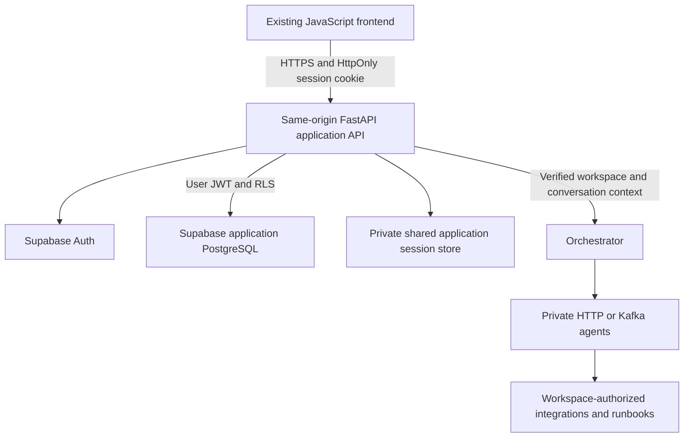

# OPU-92: authentication and client workspace architecture

Audit completed: October 12, 2026 (America/Toronto). Source baseline:
`a6e2fc8843e0bf20b4dc2c7ea794b87c32195331` on `joint`.

This is the implementation contract for Week 5, not evidence that authentication
or tenant isolation already exists. OPU-93–98 deliver the subsequent work.
Week 4's OPU-91 private preview gate remains unchanged. Existing regression
issues remain in Week 6; no existing deliverable is replaced.

## Product decisions

- User-confirmed: first client release is an **approved-client beta**.
- User-confirmed: client projects and saved investigations are retained **until
  the client deletes them**. Do not apply the demo history's 72-hour expiry to
  account data. Indefinite retention still needs storage quotas, client deletion,
  account closure handling and documented backup retention before release.
- Reuse vanilla JavaScript, CSS tokens, hash navigation and FastAPI. No framework
  rewrite, billing, invitations, complex roles or uploads in this increment.
- One personal workspace per verified user initially; membership relationships
  permit team workspaces later. Personal investigations are owner-private.
- The beta may use account-backed demo work. Shared live operational services
  require the separate isolation acceptance gate below before client access.

## Confirmed current architecture

| Component | Source evidence | Current boundary |
| --- | --- | --- |
| Frontend | `web/package.json`, `public/app.js`, `public/ui.js` | No framework dependencies; hash routes; rendering uses escaped text |
| Static delivery | `web/scripts/files.mjs`, `build.mjs`, `server.mjs` | Ten allowlisted assets; development loopback server; new modules require explicit build inclusion |
| Browser adapter | `web/public/api.js` | Same-origin requests with `credentials: 'omit'`; health success is reachability, not authentication |
| Development gateway | `web/scripts/gateway.mjs` | Four read/query routes; literal loopback origins; no cookies or authorization forwarded |
| Orchestrator | `orchestrator/main.py`, `memory.py`, `graph.py` | No auth dependency on `/ask`; browser-supplied session ID; per-process history |
| Agent transport | `shared/models.py`, `shared/agent_bus.py` | HTTP by default, optional Kafka; envelopes lack verified workspace identity |
| RAG database | `database/init.sql`, `agents/rag/retriever.py`, `ingestor.py` | Shared `document_chunks`; vector(3072); unscoped retrieval and source-based replacement |
| Other sources | `agents/monitoring/agent.py`, `infra/agent.py`, `code/agent.py`, Compose | Deployment-wide monitoring/cloud/cluster/repository settings |
| Demo history | `web/public/history.js` | Origin/browser storage, 72-hour creation-based expiry, twenty conversations; no account protection |
| Hosting/CI | `validation/OPU-91.md`, root workflow | Private static preview recorded; production API routing, headers and second viewer acceptance incomplete |

The deployed preview's current access policy was not rechecked in this audit.
The existing manifest and validation report establish historical deployment,
not proof that the host supports a production Python API or public callbacks.
Environment secrets were not inspected or copied.

## Target architecture

Serve static assets and `/api/*` through one HTTPS origin. Route `/api/*` and real
auth callback paths to FastAPI using a reverse proxy or an API-capable host.
Keep agents, monitoring administration, Kafka and database management private.
The existing Node server remains a development preview, not the production
authentication boundary. Add focused routers/services under the existing
orchestrator application rather than another production Node business backend.

Supabase will initially store accounts and application records. Keep the local
RAG database and its embeddings unchanged until a distinct tenant-aware migration
is tested. Supabase supports PostgreSQL/pgvector, but that compatibility alone
does not make current ingestion/retrieval client-safe.

## Authentication and session contract

Prefer an opaque application session cookie. Supabase access/refresh tokens stay
server-side in an encrypted, durable session store shared across replicas. Store
only a hash of the opaque cookie ID for lookup. Never serialize token material
into public profiles, client preferences, responses, browser storage or logs.

- Production cookie: `__Host-opsbrain_session`, Secure, HttpOnly, Path=/, no
  Domain attribute, SameSite=Lax. Use an explicitly separate local HTTP setup.
- Proposed application policy: seven-day absolute session lifetime and a
  24-hour idle timeout, subject to review. Provider-token lifetimes remain
  independently configured. Retention of saved work is not session lifetime.
- Coordinate refresh by application session, atomically replacing refreshed
  tokens. Do not share a mutable authenticated Supabase SDK client across users.
- Validate provider identity server-side. If validating JWTs locally, verify
  signature/JWKS, allowed algorithm, issuer, audience and expiry. Never trust a
  decoded payload or client email as authentication.
- Logout revokes the application session immediately, removes its cookie and
  requests provider logout. Define other-device behavior explicitly; existing
  provider access tokens may remain valid until expiry. Account suspension and
  credential recovery must also invalidate affected application sessions.
- All authenticated mutations, including logout, require CSRF protection and
  exact allowed Origin checks. Auth callbacks have a separate one-time state/
  verifier path. SameSite and CORS are supplementary controls.
- Apply auth and per-workspace usage limits. Failed auth responses do not reveal
  whether an email exists. Do not log passwords, tokens or callback query strings.

Expose auth actions through the same-origin backend. Existing browser requests
must switch to same-origin credentials only for the new authenticated contract;
keep demo fixtures and the development gateway independently testable.

### Proposed endpoint contract (not implemented)

| Endpoint | Method | Required behavior |
| --- | --- | --- |
| `/api/auth/signup` | POST | Validate input and beta eligibility; invoke provider; return generic check-email response |
| `/auth/callback` | GET | Consume one-time verification/code flow, validate state, clear sensitive URL, redirect internally |
| `/api/auth/login` | POST | Authenticate; issue opaque cookie; return verified account state |
| `/api/auth/session` | GET | Return minimal identity, verified state and accessible memberships; no tokens; no-store |
| `/api/auth/logout` | POST | CSRF-protected revocation; clear cookie and page state |
| `/api/auth/recovery` | POST | Generic email response with rate limiting |
| `/api/auth/password` | POST | Require authenticated/verified recovery context; revoke sessions per policy |
| `/api/workspaces/provision` | POST | Verified identity, beta approval and retry-safe personal workspace transaction |
| `/api/workspaces/{id}/projects` | GET/POST | Membership checks, pagination, server-derived ownership |
| `/api/workspaces/{id}/projects/{projectId}` | GET/PATCH/DELETE | Match project to workspace; field allowlist; optimistic version checks |
| `/api/workspaces/{id}/conversations` | GET/POST | Membership plus conversation ownership; bounded, retry-safe writes |
| `/api/workspaces/{id}/conversations/{conversationId}` | GET/PATCH/DELETE | Owner-private records; preserve answer/source/result provenance |

Use safe error codes: 401 for absent/expired identity, 403 for verification or
beta eligibility failure, 404 for inaccessible scoped resource IDs, 409 for
conflicting versions, 422 for invalid fields and 429 for rate limits. Provider
outages return safe 503 responses. Responses containing private data use
Cache-Control: no-store and must not enter a public CDN cache.

### Verification, approval and routing

Beta eligibility is a server-owned approval list, matched to verified identity.
It is separate from workspace membership and from the private preview's host
viewer list. The two existing viewer emails have not been supplied; do not invent
them or treat any signed-in identity as approved. Public signup remains disabled
until explicitly released. Auth pages can explain approved-beta eligibility.

Homepage Login/Sign Up actions lead to dedicated hash views. Resolve session
before displaying any private content. A verified, approved user with no
workspace completes onboarding; retries resume it. Existing users reach their
last accessible workspace/resource or fall back to Overview. Validate both the
internal destination and its authorization; reject external redirects.

URL fragments are not sent to the backend. Verification and reset templates
must target actual server callback paths. Choose a provider-supported token-hash
verification or PKCE flow during OPU-93 and test expired, replayed and cross-device
links. A different device may complete verification then require login. Callback
state and recovery permissions must never become a general-purpose login bypass.

## Data relationships and policies

| Proposed entity | Relationships and constraints | Access |
| --- | --- | --- |
| Provider users | Supabase-managed identity | Provider manages credentials |
| profiles | Primary key references auth user; validated display name/preferences | Own row; immutable user ID |
| workspaces | UUID, creator, name, timestamps | Active membership required; owner updates settings |
| workspace_members | Unique workspace/user; role initially owner | Own memberships readable; no client role/membership mutation |
| projects | Workspace ID, creator, title, timestamps, version | Membership and explicit write role; workspace immutable |
| conversations | Workspace/project/owner IDs, title, provenance, version | Membership plus owner identity in initial beta |
| conversation_turns | Conversation ID, sequence, bounded question/answer/sources/results | Inherit parent ownership; unique retry/sequence constraints |
| activity_events | Workspace, actor, event type, resource reference, time | Authorized metadata only; server creates events |
| app_sessions / beta approvals | Private server-only schema, protected token material | Not exposed through browser/Data API or user grants |

Use composite constraints so a project referenced by a conversation belongs to
that same workspace. Explicitly prevent ownership/workspace changes through PATCH.
RLS must protect all operations with both row eligibility and write checks.
Membership policies must not recursively query themselves; use a narrow reviewed
helper where necessary with a fixed search_path and restricted execution grants.
Index workspace/user membership lookups. Roles are authorization, not profile
metadata that a user can edit.

Use user-token-scoped Data API calls for ordinary account records so auth.uid()
is evaluated by Supabase. Direct Python SQL does not automatically inherit that
user context; do not assume a privileged connection enforces RLS. Isolate narrow
server-only bootstrap/session operations from user data-access clients. Never use
the administrative secret as a blanket CRUD client.

Provision after verification and beta approval: a single transaction creates or
finds the personal workspace, inserts its owner membership and updates the
profile. Enforce a unique personal-owner constraint and recoverable retries.
Signup itself must not create unrestricted access or privileged memberships.

### Persistence and deletion

Saved work is account-backed and retained until explicit deletion. Store only
displayed questions/answers, source references, agent outcomes and necessary
timestamps; no hidden model reasoning or integration credentials. Preserve
Demo/Live provenance. Bound record size and paginate; define storage quotas before
the beta opens. Existing demo history remains separate and keeps its current
creation-based 72-hour behavior.

Project/conversation deletion requires explicit authorization and transactional
child cleanup. A project deletion must disclose that its saved investigations
will also be deleted. Active sessions and in-process conversation caches must
not resurrect deleted records. Account-closure operations delete/revoke owned
records and sessions. Backup copies may persist for a documented backup window;
do not promise immediate removal from all backups. No automatic expiry job is
planned for account investigations. Billing is later workspace-owned.

## Live operational isolation gate

| Finding | Required future correction | Owner sprint/gate |
| --- | --- | --- |
| Anonymous `/ask` and globally keyed session memory | Verify identity/membership; server-owned conversation lookup and tenant-keyed/shared history | OPU-95 and OPU-97; required before client live access |
| RAG retrieval searches all chunks | Authorized workspace corpus filter plus SQL/RLS enforcement and two-client retrieval tests | Separate live-integration work after auth foundation |
| Ingestion deletes matching source names globally | Scope insert/delete and source uniqueness to workspace; test same filename in two clients | Separate tenant-aware ingestion work |
| Monitoring/cloud/GitHub targets are deployment-wide | Resolve authorized integration from workspace server-side; never accept arbitrary URLs/credentials from browser | Separate live-integration work |
| Agent envelopes lack workspace identity | Pass authenticated internal tenant context over both HTTP and Kafka; secure service identity/broker access | Separate transport/integration hardening |
| Code rerun/dispatch routes are mutating and unauthenticated | Keep them private and outside the client allowlist; require distinct permissions if ever exposed | OPU-91/private-network gate; actions outside Week 5 |

Do not make existing local APIs inaccessible without coordinating CLI/engineer
compatibility; preserve the local workflow while building a separate protected
client entry path. Production ingress must not expose the old unauthenticated
path as a bypass. Correlation IDs, random conversation IDs and CORS are not
authorization. Provider calls and replies also require tenant-scoped caches and
safe error output before serving real client content.

## Dependencies, environments and handoff

Supabase supports Python Auth/database clients and PostgreSQL/pgvector. Existing
FastAPI/httpx/psycopg can remain. OPU-93 selects/pins the Python auth client,
JWT verification, token encryption and migration tooling after compatibility
tests with the current Python 3.11 service images and dependency ranges. Browser
Supabase SDK is unnecessary for the proposed server-session boundary. No new
dependency was installed during this audit.

Proposed server-only settings: SUPABASE_URL, SUPABASE_PUBLISHABLE_KEY,
SUPABASE_SECRET_KEY (administrative operations only), APP_ORIGIN,
SESSION_ENCRYPTION_KEY and private database connection settings. SMTP secrets
belong in the provider control plane. Use different provider projects, callback
origins and keys for development/staging/production; never reuse production
client data in tests. The build still copies only allowlisted public assets.

Proposed modules: `orchestrator/auth/`, `workspace/`, `projects/`,
`conversations/`, `shared/tenant_context.py`, `supabase/migrations/` and
`supabase/tests/`; frontend controllers `auth.js`, `route-guards.js`,
`workspace.js`, `projects.js`, `settings.js`. Add modules as their tickets ship,
not empty scaffolding during the audit.

### Decisions still needing real deployment information

| Decision | Current state | Before |
| --- | --- | --- |
| API-capable host and same-origin reverse proxy | Not selected/verified; current deployment is static | OPU-93 environment setup and OPU-98 staging |
| Supabase project, region and budget | Not supplied; do not infer geography from the user's timezone | OPU-93 provisioning |
| SMTP sender/domain and delivery owner | Not supplied; default provider SMTP is not a client-release solution | OPU-94 verification/recovery acceptance |
| Approved beta identities and access owner | Release policy confirmed; identity list not supplied | Client account provisioning |
| Calendar and capacity | Week 4 incomplete; Week 5 dates unset; Week 6 target Oct 16; historical project target Oct 7 conflicts | Scheduling review before delivery promise |
| Storage quotas and backup/deletion window | Indefinite client retention confirmed; limits/backup window need budget decision | Persistence release acceptance |

Until these values are supplied, this contract is ready for review, but external
setup and production-readiness cannot be marked complete. Week 5 is seven work
packages, not seven independent calendar sprints. Estimate implementation against
two engineers' actual availability; security/session work is on the critical path.

## Acceptance matrix

OPU-93 tests clean migrations, bootstrap retries and RLS with anonymous, user A,
user B and forged ownership. OPU-94 tests signup/login/recovery/verification with
actual email delivery. OPU-95 tests callback state, CSRF, safe redirects, refresh
races, restart/replica session persistence, logout and cross-workspace access.
OPU-96 covers responsive/keyboard workspace navigation. OPU-97 tests project CRUD,
save/logout/relogin/resume, concurrent writes and deletion without resurrection.
OPU-98 repeats browser journeys, private API/RLS denial tests and regressions,
then records deployment/rollback and the live isolation gate where applicable.

## Vendor references checked during audit

- [Supabase Python client](https://supabase.com/docs/reference/python/introduction)
- [JWT verification](https://supabase.com/docs/guides/auth/jwts)
- [RLS and privileged access](https://supabase.com/docs/guides/database/postgres/row-level-security)
- [Production SMTP](https://supabase.com/docs/guides/auth/auth-smtp)
- [PostgreSQL vector support](https://supabase.com/docs/guides/database/extensions/pgvector)

## Related records

- [Current roadmap and preserved live-data follow-ups](../validation/website-sprint-plan.md)
- [OPU-92 audit/verification evidence](../validation/OPU-92.md)
- [Week 4 private deployment gate](../validation/OPU-91.md)
